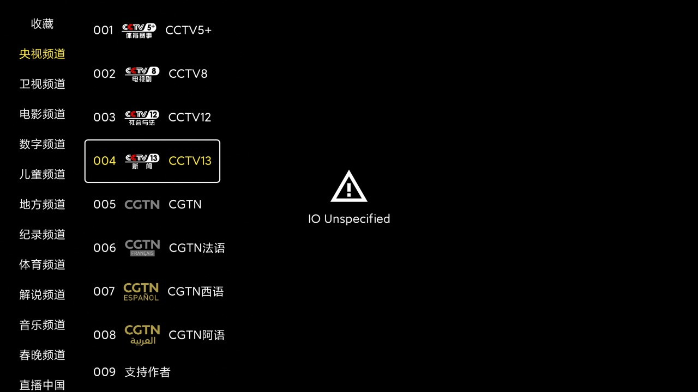
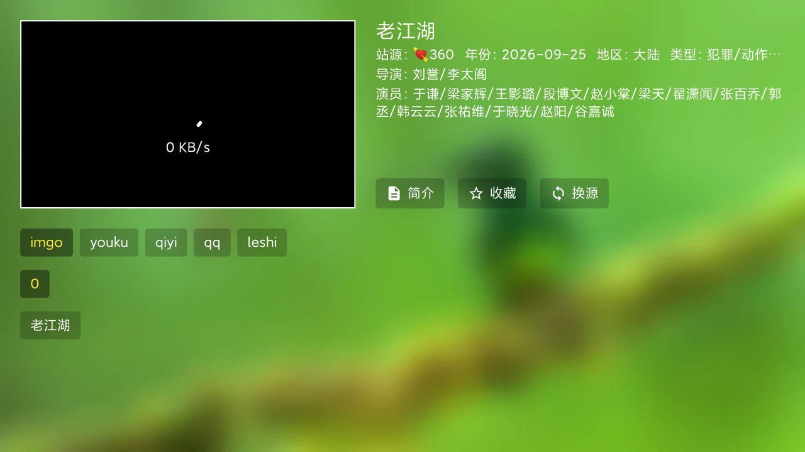

# TVBox on an Android TV, over ADB

Companion to the main CleanYourTV flow. CleanYourTV removes the ads and replaces the
launcher; this lays a **player** on top so the TV can actually watch something without a
cable box.

Everything here runs from a laptop on the same Wi-Fi, over `adb`. No root, nothing is
uninstalled, and the TV keeps its stock launcher.

```
laptop ──adb(TCP 5555)──▶ TV
                            └── /sdcard/TV/   ← configs live here, readable by the app
```

## What you end up with

| | |
|---|---|
|  |  |
| Home: 点播 / 直播 / 搜索 / 收藏 / 连接 / 设置 | 点播 loads posters, ratings and tabs |
|  |  |
| 直播 with real groups instead of a flat list | Detail page with lines and episodes |

## 0 · Before you touch anything

1. TV: Settings → About → tap **Build** 7×, then Developer options → **USB debugging** on.
2. `adb devices` on the laptop, accept the prompt on the TV.
3. Note the TV's IP; wireless ADB is `adb connect <ip>:5555`.

`scripts/discover-tv.sh` does steps 2–3 and prints the serial it found.

**Ask before installing or changing config.** The user is the one who has to live with
the result.

## 1 · Install a player

TVBox (FongMi fork, `com.fongmi.android.tv`) is the usual pick: one APK, handles both
点播 (site spiders) and 直播 (m3u/txt lists), plus a phone-style web remote.

```bash
adb -s "$SERIAL" install -r TVBox-<version>.apk   # sideload; Play Store has no TVBox
adb -s "$SERIAL" shell am start -n com.fongmi.android.tv/.ui.activity.HomeActivity
```

If the user already has it, skip — just read the version from 设置 so you know which UI
you are driving.

## 2 · Understand how config gets in

TVBox keeps three addresses in preferences:

| pref | row in 设置 | what it is |
|---|---|---|
| `config_0` | 点播 | a site config: `sites[]`, `parses[]`, `spider` jar |
| `config_1` | 直播 | a channel list: `.m3u` or `.txt` |
| `config_2` | 壁纸 | wallpaper URL |

Three ways to set them, in order of reliability:

1. **On-screen 设置 dialog** — D-pad onto the row, OK, type. Always works. This is the
   one to use. See §3 for the typing quirks.
2. **Backup patch** — `/sdcard/TV/backup/YYYY-MM-DD.tv` is gzip-compressed JSON holding
   `config[]` and `prefers{config_0..2}`. Rewrite it, restore from 设置 → 备份恢复.
   Fast, but the app re-writes the backup on restart and can drop your patch — treat it
   as a shortcut, not a guarantee.
3. **Web remote on port 9978** — `POST /action` with `do=setting&name=<pref>&text=<url>`.
   Only real pref keys stick. Invented keys like `api_url` return `OK` and persist
   nothing, which is a great way to waste twenty minutes.

### The `file://TV/...` trick

`file://TV/foo.json` resolves to `/sdcard/TV/foo.json`. Push the config once and point
the pref at the local copy: the box stops depending on a URL that may be dead next week.
Do this for anything the user will keep.

```bash
adb -s "$SERIAL" push config/vod-xhz-54sites.json /sdcard/TV/vod.json
adb -s "$SERIAL" push config/live-cn-466.txt      /sdcard/TV/live.txt
# 点播 → file://TV/vod.json     直播 → file://TV/live.txt
```

## 3 · Typing a URL on the TV

TVBox's address dialog uses a `CustomEditText` that rewrites what you type. Two traps,
both of which produce a URL that *looks* fine and resolves to nothing:

- Typing the scheme yourself **duplicates it**: `input text "http://a.b/c"` →
  `http://ttp://a.b/c`. The dialog expanded the leading `h` and kept the rest.
- Same for files: `file://TV/x` → `file://ile://TV/x`.

Do this instead:

```bash
# clear whatever is in the field first
seq 1 40 | xargs -I{} adb -s "$SERIAL" shell input keyevent KEYCODE_DEL

# plain host: type it WITHOUT the scheme, the dialog prepends http://
adb -s "$SERIAL" shell input text "example.com/config.json"

# file:// : type the single letter, let it expand, then append
adb -s "$SERIAL" shell input text "f"
adb -s "$SERIAL" shell input keyevent KEYCODE_MOVE_END
adb -s "$SERIAL" shell input text "ile://TV/vod.json"
```

The Sogou TV IME (`com.sohu.inputmethod.sogou.tv`) steals keystrokes and pops
"已启用实体键盘输入". If text goes missing:

```bash
adb -s "$SERIAL" shell settings put secure show_ime_with_hard_keyboard 1
```

## 4 · Pick sources that survive

Two shapes, and the choice matters:

- **多仓 / multi-warehouse** (`{"urls":[{"name":…,"url":…}]}`) — one address, many
  configs, the app falls back when one dies. Good default. `sources.md` lists the ones
  that answered on the day this was written, and the ones that did not.
- **Single-file config** — one site set, usually 20–60 sites plus a spider jar.
  Predictable, and the file is small enough to keep offline.

Free Chinese sources rot fast. The rule that keeps a TV working:

> Anything the user will actually use gets copied to `/sdcard/TV/` and referenced as
> `file://TV/...`. Remote URLs are for bootstrapping, not for the final state.

## 5 · Verify — and do not trust the obvious signals

This is where most of the time goes. Four traps, all hit in practice:

**Do not test reachability from the laptop.** The dev machine is often behind a VPN
(`utun`/TUN, `default → 192.168.x.x` on a utun interface). It will happily fetch sources
the TV cannot reach, and you will ship a config that fails on the couch. Probe **from the
TV**:

```bash
adb -s "$SERIAL" shell 'printf "GET /path.m3u8 HTTP/1.0\r\nHost: host\r\n\r\n" \
  | toybox nc -w 8 host 80 | head -3'
```

`scripts/probe-from-tv.sh` runs this over a list of URLs and keeps the ones that answer.

**Do not use `ping` as a reachability test.** China Mobile / Unicom IPTV hops drop ICMP
at ~100 % while TCP and HTTP on the same address work fine. A `ping` failure means
nothing here.

**`screencap` cannot capture the video layer.** Hardware decoding (`AmlogicVideoDecoder`,
MediaCodec) draws to an overlay that `adb exec-out screencap` renders **black**. A black
screenshot is not a failed stream. Check the two things that actually move:

```bash
# 1. is the decoder running?
adb -s "$SERIAL" logcat -d -t 300 | grep -iE 'AmlogicVideoDecoder|MediaCodec|avc'

# 2. is data flowing?  sample wlan0 rx twice
adb -s "$SERIAL" shell 'a=$(grep wlan0 /proc/net/dev|tr -s " "|cut -d" " -f3);
  sleep 3; b=$(grep wlan0 /proc/net/dev|tr -s " "|cut -d" " -f3);
  echo $(( (b-a)/3/1024 )) KB/s'
```

A few hundred KB/s to a couple of MB/s with the decoder alive = it is playing. Trust
that over the screenshot.

**`uiautomator dump` is empty on some MiTV firmware.** Drive the UI with D-pad
`keyevent`s and compare screenshot md5s to tell "still loading" from "nothing happened".

### Error messages and what they mean

| On screen | Cause | Fix |
|---|---|---|
| `这里什么都没有 👀` | the site's detail endpoint is broken, not your config | open another title, or another site |
| `播放地址解析失败` | the site needs a web 解析 and none of the `parses[]` worked | another 线路, or a site that returns m3u8 directly |
| `IO Unspecified` | the playlist loaded but a segment/CDN is unreachable or expired | re-probe from the TV; the host is probably blocked |
| `Network Connection Failed` | host unreachable from this ISP | drop the source |
| endless `0 KB/s` | DNS or TCP stalls | check `Host:` reachability from the TV |

## 6 · Leave it recoverable

Before changing anything, pull the current state:

```bash
adb -s "$SERIAL" shell ls -t /sdcard/TV/backup/ | head -1   # the app writes these itself
adb -s "$SERIAL" pull "/sdcard/TV/backup/$(…)" ./before.tv
```

`before.tv` is gzip JSON. Restoring it from 设置 → 备份恢复 puts every pref back. Tell the
user where you put it.

## 7 · Record what worked

Source lists are worthless without a date. `sources.md` is a table with a "checked"
column — fill it in as you go, and leave the failures in. Next person saves an hour.
